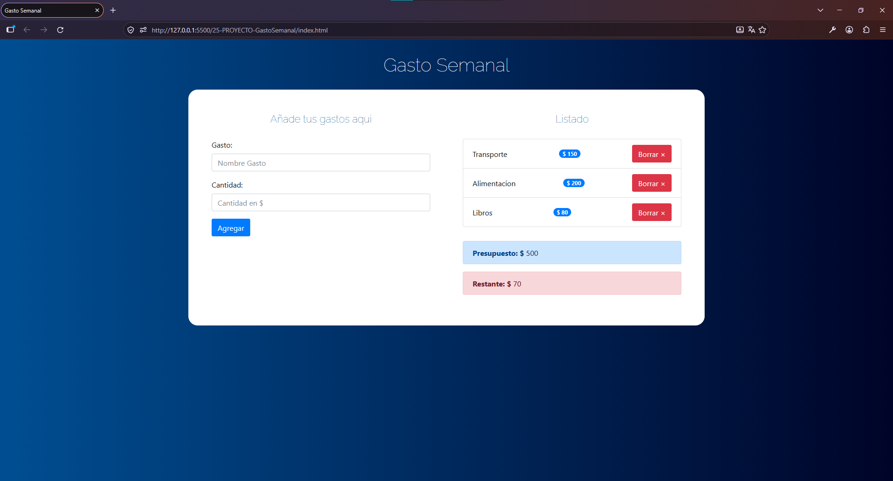

# 💰 Gasto Semanal — Administrador de Presupuesto

Aplicación web desarrollada con **JavaScript, HTML5 y CSS3** que permite establecer un presupuesto inicial y administrar los gastos registrados, calculando automáticamente el dinero disponible.

Este proyecto forma parte de mi aprendizaje de JavaScript y está enfocado en la práctica de la **programación orientada a objetos mediante clases**, la manipulación del DOM y la gestión de eventos.

## 🚀 Demo

🔗 [Ver aplicación en GitHub Pages](https://cristhianychr.github.io/gasto-semanal-js/)

## Vista previa



## ✨ Funcionalidades

- **Definir presupuesto inicial:** el usuario ingresa su presupuesto al iniciar la aplicación.
- **Registrar gastos:** permite añadir gastos indicando su nombre y cantidad.
- **Validar información:** verifica que los campos estén completos y que el importe sea válido y positivo.
- **Visualizar gastos:** muestra los gastos registrados con sus respectivos importes.
- **Eliminar gastos:** permite retirar un gasto de la lista y recalcular el saldo disponible.
- **Calcular el saldo restante:** actualiza automáticamente el dinero disponible después de registrar o eliminar gastos.
- **Alertas de validación:** muestra mensajes de error o confirmación al realizar determinadas acciones.
- **Indicadores visuales del presupuesto:** cambia el color del saldo restante según el nivel de consumo del presupuesto.
- **Control del presupuesto agotado:** muestra una alerta y deshabilita el botón para agregar gastos cuando el saldo es igual o inferior a cero.

## 🛠️ Tecnologías utilizadas

- **HTML5:** estructura de la aplicación y formulario de registro.
- **CSS3:** estilos personalizados y diseño visual.
- **Bootstrap:** componentes y clases de estilo para formularios, botones, alertas y listas.
- **JavaScript (ES6+):** lógica de la aplicación, validaciones y cálculos.
- **Git y GitHub:** control de versiones y publicación del proyecto.

## 🧠 Conceptos de JavaScript aplicados

- Clases y programación orientada a objetos.
- Constructores, propiedades y métodos.
- Creación de instancias mediante `new`.
- Manipulación del DOM con `querySelector`, `createElement` y `classList`.
- Gestión de eventos con `addEventListener` y `preventDefault`.
- Manejo de formularios y validación de datos.
- Métodos de arreglos como `filter`, `reduce` y `forEach`.
- Operador de propagación (*spread operator*).
- Desestructuración de objetos.
- Funciones flecha.
- Identificación de gastos mediante valores únicos generados con `Date.now()`.

## 📂 Estructura del proyecto

```text
gasto-semanal-js/
├── css/
│   ├── bootstrap.min.css
│   └── custom.css
├── img/
│   └── preview.png
├── js/
│   └── app.js
├── index.html
└── README.md
```

## ⚙️ Instalación y ejecución

1. Clona el repositorio:

   ```bash
   git clone https://github.com/cristhianychr/gasto-semanal-js
   ```

2. Accede a la carpeta del proyecto:

   ```bash
   cd gasto-semanal-js
   ```

3. Abre el archivo `index.html` en tu navegador.

No es necesario instalar dependencias de Node.js ni ejecutar un servidor para utilizar la versión básica de esta aplicación.

## 📌 Aprendizajes

El desarrollo de este proyecto me permitió practicar la separación de responsabilidades mediante las clases `Presupuesto` y `UI`: una administra los datos y los cálculos del presupuesto, mientras que la otra se encarga de actualizar la interfaz.

También reforcé el uso de arreglos para administrar gastos, la validación de formularios y la actualización dinámica de elementos HTML en respuesta a las acciones del usuario.

## 👨‍💻 Autor

Proyecto desarrollado como parte de mi formación práctica en JavaScript y desarrollo web frontend.

**Cristhian Chanamé**  
Estudiante de Ingeniería de Software.